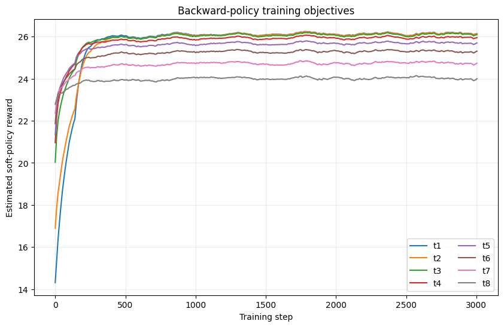
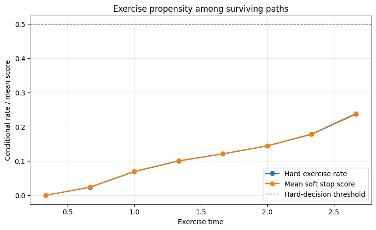
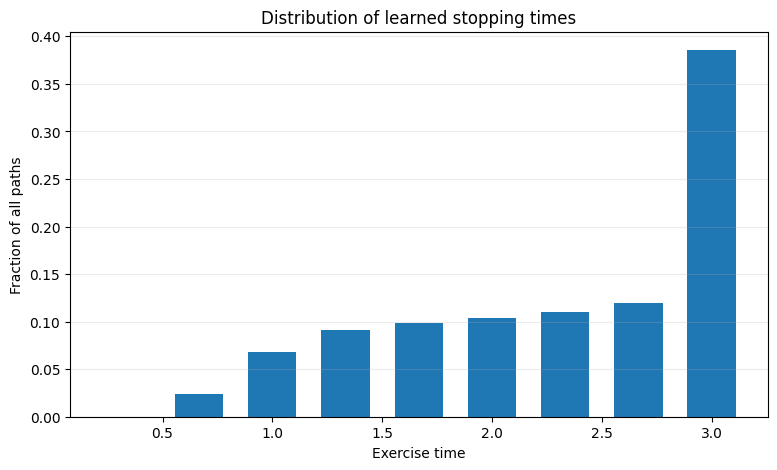
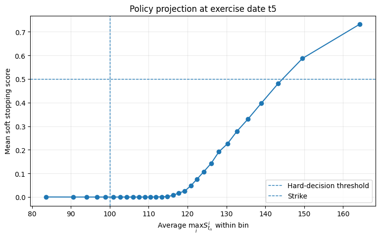
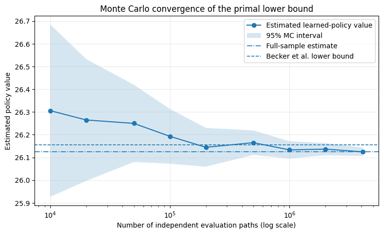

# Deep Optimal Stopping for Bermudan Max-Call Options

This repository studies **optimal exercise with deep learning** through the Bermudan max-call benchmark of Becker, Cheridito & Jentzen (2019).

The main idea is simple: instead of learning the option price directly, I learn **when to exercise**. At each Bermudan exercise date, a neural network produces a stop/continue decision. The policies are trained backward in time on Monte Carlo paths, then frozen and evaluated on an independent sample to obtain a **primal lower bound** for the option value.

The current repository focuses on the first part of the method: **learning the stopping policy and reproducing the lower-bound benchmark**.

**Current notebook:** [`01_deep_optimal_stopping_lower_bound_.ipynb`](notebooks/01_deep_optimal_stopping_lower_bound_.ipynb)

## Why this problem?

A Bermudan option can only be exercised on a finite set of dates. Pricing it is therefore an **optimal stopping problem**: at each exercise date, the holder must decide whether the immediate payoff is preferable to the value of continuing the contract.

For a max-call written on $d$ assets, the discounted reward at exercise date $t_n$ is

$$
g(n,S_{t_n}) = e^{-rt_n}\left(\max_{1\le i\le d} S^i_{t_n}-K\right)^+.
$$

The option value is

$$
V_0 = \sup_{\tau\in\mathcal T}\mathbb E\left[g(\tau,S_{t_\tau})\right],
$$

where $\tau$ is a stopping time taking values on the Bermudan exercise grid.

The difficulty is that, at each exercise date, the holder must compare the immediate payoff with the continuation value — the expected value of keeping the option alive and exercising optimally later. Approximating this continuation value becomes increasingly expensive as the state dimension grows. Becker et al. address this by learning the stopping policy directly with neural networks.

## Method

The implementation follows the **primal Deep Optimal Stopping** procedure:

1. **Simulate the underlying assets** under a multidimensional Black-Scholes model.
2. **Augment the state** with the immediate discounted payoff, as in Becker et al.
3. **Train one neural stopping rule per exercise date**, working backward from maturity.
4. Use a differentiable **soft stopping score** during optimization and threshold it at $0.5$ to obtain a deterministic exercise rule.
5. **Freeze the learned policy** and evaluate it on a new, independent Monte Carlo sample.
6. The expected payoff of this admissible policy gives a **lower bound** on the true Bermudan option value.

The benchmark implemented here is the symmetric $d=5$ case from the paper:

| Parameter | Value |
|---|---:|
| Number of assets $d$ | 5 |
| Initial prices $S_0$ | 100 |
| Strike $K$ | 100 |
| Risk-free rate $r$ | 5% |
| Dividend yield $\delta$ | 10% |
| Volatility $\sigma$ | 20% |
| Pairwise correlation $\rho$ | 0 |
| Maturity $T$ | 3 years |
| Exercise intervals $N$ | 9 |

The training budget also follows the benchmark setup: **3,005 optimization steps**, batches of **8,192 newly simulated paths**, and **4,096,000 independent paths** for the final lower-bound evaluation.

## Main result

The independently trained stopping policy gives:

|  | Lower bound |
|---|---:|
| Becker et al. (2019) | **26.156** |
| This implementation | **26.124706** |
| Relative difference | **0.12%** |

The final policy value is estimated with a Monte Carlo standard error of approximately **0.0096**.

This is a close numerical reproduction of the published primal benchmark. The remaining difference is larger than the final Monte Carlo evaluation noise, so the residual discrepancy is mainly associated with the learned policy and training randomness rather than with valuation noise alone.

Importantly, a lower bound does **not** certify that the policy is optimal. Measuring the remaining optimality gap requires the dual martingale upper bound, which is the natural next extension of the project.

## Training and policy diagnostics

The notebook does more than report a final price. I also inspect whether the learned stopping strategy behaves consistently.

### Backward policy training

Each exercise date solves a different stop/continue problem. The training objectives stabilize at date-dependent levels as the networks are optimized backward through the exercise grid.

<p align="center">
  
</p>

### Learned exercise behavior

The policy exercises relatively few paths early in the contract and becomes more aggressive as maturity approaches. In the reference run, approximately **61.4%** of diagnostic paths are exercised before expiry, while **38.6%** reach maturity.

<p align="center">
  
</p>

The distribution of realized stopping times provides another view of the resulting Bermudan exercise strategy.

<p align="center">
  
</p>

### Interpreting the neural stopping rule

The network does not simply learn “in the money = exercise”. The continuation value still matters. A one-dimensional projection of the learned policy shows how the average stopping score changes with the strongest underlying asset at an intermediate exercise date.

<p align="center">
  
</p>

This is only a projection of a higher-dimensional stopping surface: the true decision depends on the complete state of the five assets, not only on their maximum.

### Monte Carlo convergence

The final lower bound is evaluated out of sample. As the independent evaluation sample grows, the confidence interval contracts and the estimate stabilizes near the final value.

<p align="center">
  
</p>

This separates two distinct sources of numerical error:

- **Monte Carlo evaluation error**: uncertainty in the value of a fixed learned policy;
- **policy error**: the distance between the learned exercise rule and the unknown optimal stopping rule.

Only the first is measured by the reported Monte Carlo standard error.

## Repository structure

```text
deep_optimal_stopping/
├── notebooks
│   ├── 01_deep_optimal_stopping_lower_bound_.ipynb
├── figures/
│   ├── 01_exercise_rates.png
│   ├── 01_mc_convergence.png
│   ├── 01_policy_projection.png
│   ├── 01_stopping_times.png
│   └── 01_training_objectives.png
└── README.md
```

The notebook contains the full workflow: model setup, exact Black-Scholes simulation, neural-policy architecture, backward optimization, policy diagnostics, out-of-sample valuation and comparison with the published benchmark.

## Roadmap

- [x] **Part I — Primal lower bound:** learn the stopping policy and evaluate it out of sample.
- [ ] **Part II — Dual upper bound:** construct the martingale-based dual estimator of Becker et al.
- [ ] **Part III — Variance reduction:** study variance-reduction techniques for the dual estimator and their effect on computational efficiency.

The combination of the primal and dual estimators will make it possible to bracket the Bermudan price from both sides and quantify the remaining optimality gap.

## Reproducibility

The committed notebook contains the complete reference run and its outputs. Random seeds and the numerical configuration are fixed in the notebook. Small differences may still occur across PyTorch versions, GPU kernels or hardware, but the result should remain close to the published benchmark.

The implementation uses Python, PyTorch, NumPy, pandas, Matplotlib and tqdm.

## Reference

Sebastian Becker, Patrick Cheridito & Arnulf Jentzen (2019), **Deep Optimal Stopping**, *Journal of Machine Learning Research*, 20(74), 1–25.  
https://www.jmlr.org/papers/v20/18-232.html
